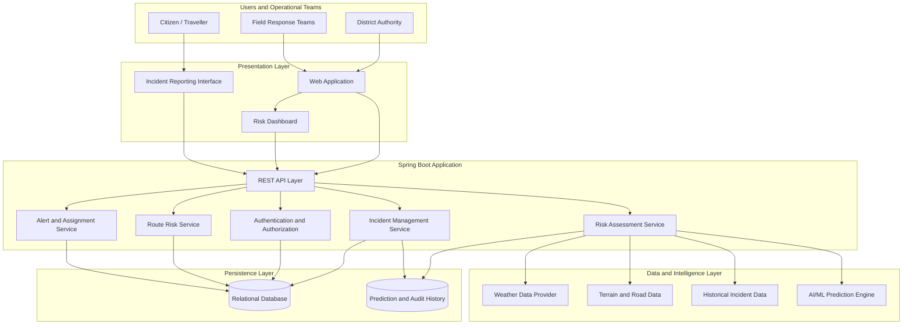
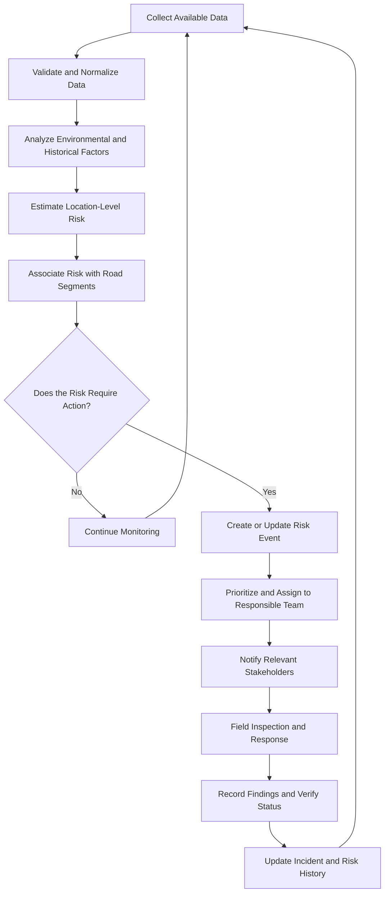
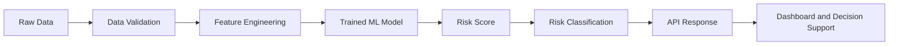
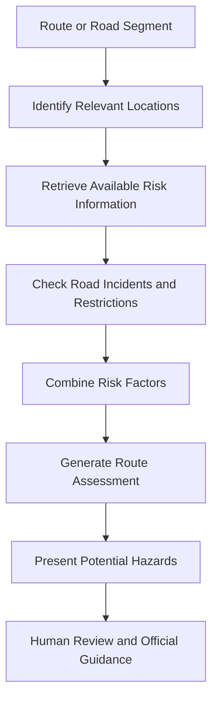
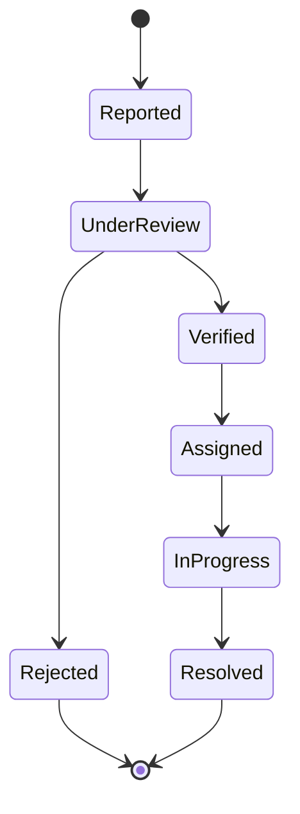

# PahadSuraksha
### AI-Powered District Road Safety, Landslide Risk Prediction & Route Management Platform

<p align="center">
  <strong>Predict Risk. Protect Routes. Enable Faster Disaster Response.</strong>
</p>

<p align="center">
  A district-focused disaster intelligence platform designed to support landslide risk assessment, road safety monitoring, route-risk analysis, and coordinated response in the Himalayan region.
</p>

---

## Overview

**PahadSuraksha** is an intelligent disaster-risk and road-safety management platform designed for mountainous regions where heavy rainfall, unstable slopes, fragile terrain, and road blockages can threaten human lives and disrupt transportation.

The project initially focuses on **Tehri Garhwal, Uttarakhand**, with an architecture that can be extended to other districts as the system evolves.

Unlike conventional navigation platforms that primarily focus on directions and travel time, PahadSuraksha aims to incorporate environmental conditions, terrain characteristics, historical incidents, and reported hazards into a unified risk-monitoring workflow.

The backend is developed using **Java and Spring Boot**, providing a foundation for REST APIs, business logic, risk assessment workflows, incident management, and communication between system components.

The long-term objective is to help district authorities identify potentially dangerous road segments, prioritize inspections, communicate risk information, and coordinate appropriate responses.

> **Important:** PahadSuraksha is intended as a decision-support system. Its predictions must not be treated as a substitute for official warnings, field verification, or decisions made by authorized disaster-management authorities.

## Problem Statement

Mountainous districts face a combination of environmental and infrastructure-related risks:

- Intense or prolonged rainfall can increase slope instability.
- Landslides can obstruct roads and isolate communities.
- Hazardous road segments may become unsafe before an incident is formally reported.
- Information about weather, incidents, and road conditions may be distributed across different systems.
- Authorities need a structured way to prioritize high-risk locations and coordinate responses.
- Travellers may lack timely, location-specific information about hazardous routes.

PahadSuraksha aims to bring these information sources and operational workflows together in a district-focused platform.

## Project Objectives

1. Develop a centralized platform for monitoring district-level road and landslide risks.
2. Integrate weather, terrain, historical incident, and field-report data where available.
3. Provide a framework for AI/ML-based landslide-risk estimation.
4. Assess risk at individual locations and road segments.
5. Support incident reporting, verification, and status tracking.
6. Help authorities prioritize field inspections and response activities.
7. Provide a foundation for targeted alerts to travellers and responsible departments.
8. Establish an extensible architecture for future deployment across Uttarakhand.

## Key Capabilities

| Capability | Purpose |
|---|---|
| District Risk Monitoring | Organize risk information by district and location. |
| Weather Intelligence | Use rainfall and other relevant weather observations when connected to a data provider. |
| Landslide Risk Assessment | Estimate potential risk using available environmental and historical data. |
| Route Risk Analysis | Identify potentially hazardous road segments using available risk and road-network data. |
| Incident Management | Record, track, and review reported road hazards and landslide incidents. |
| Authority Workflow | Support assignment, verification, and response tracking. |
| Alert Management | Provide a framework for communicating relevant risk information. |
| Historical Analysis | Support trend analysis and model evaluation using historical records. |
| Expandable Architecture | Allow additional districts, data providers, and prediction models to be integrated later. |

*The capabilities listed above describe the project scope. Their availability in a deployed instance depends on the corresponding modules and integrations being implemented.*

---

## System Architecture

The following diagram illustrates the intended high-level architecture. It is a logical design, not a claim that every integration is already operational.



### Architectural Responsibilities

**Presentation layer**
- Displays district and location-level information.
- Provides dashboards, incident forms, and risk summaries.
- Communicates with the backend through HTTP APIs.

**Spring Boot application**
- Validates requests and applies business rules.
- Handles authentication and role-based authorization.
- Coordinates incident workflows, risk calculations, and route assessments.
- Persists records and exposes structured API responses.

**Data and intelligence layer**
- Supplies environmental, terrain, road-network, and incident data.
- Supports the integration of a trained prediction model.
- Produces risk assessments that can be stored and reviewed.

**Persistence layer**
- Stores users, incidents, assignments, and other application records.
- Supports traceability of predictions and operational actions where implemented.

## Operational Workflow

PahadSuraksha follows an observe–assess–prioritize–respond approach.



### Workflow Explanation

1. **Observe:** Obtain available weather, terrain, road, and incident information.
2. **Validate:** Check data quality, timestamps, missing values, and geographic references.
3. **Assess:** Evaluate the relevant factors using defined rules or a trained ML model.
4. **Locate:** Associate assessments with identifiable locations or road segments.
5. **Prioritize:** Identify events that may require further inspection or intervention.
6. **Assign:** Route actionable events to an authorized team or responsible department.
7. **Communicate:** Deliver alerts through supported channels when configured.
8. **Verify:** Record field findings, response status, and incident resolution.
9. **Learn:** Use verified historical records to support monitoring and future model evaluation.

A high predicted risk should trigger appropriate review and precautionary action, not automatically be interpreted as confirmation that a landslide will occur.

---

## AI/ML Risk Assessment

The AI/ML component is intended to estimate landslide susceptibility or near-term risk using relevant environmental and historical observations.

### Potential Input Features

| Feature group | Example features |
|---|---|
| Weather | Recent rainfall, accumulated rainfall, rainfall intensity, temperature, humidity |
| Terrain | Elevation, slope, aspect, terrain characteristics |
| Geological context | Available soil, lithology, and geological information |
| Historical records | Previous landslides, road blockages, incident frequency |
| Road conditions | Road-segment location, nearby slope conditions, reported obstructions |
| Temporal context | Time window, seasonal patterns, recent changes in conditions |

Feature availability and suitability depend on the actual data sources, coverage, and quality.

### Proposed Prediction Pipeline



### Model Strategy

The prediction component can be designed around a supervised learning model trained on appropriately labelled historical data.

Potential approaches include:

- **XGBoost:** A candidate for structured environmental and historical features.
- **Random Forest:** A baseline for comparison and feature-importance analysis.
- **CNN-based models:** A possible future option for suitable image or spatial-grid inputs when sufficient labelled imagery is available.

The selected model must be validated against the intended prediction target and available dataset. No particular model should be considered production-ready solely because it is integrated into the application.

### Risk Classification

An illustrative classification scheme is shown below.

| Risk category | Interpretation | Suggested action |
|---|---|---|
| Low | Lower estimated risk under the available data and model | Continue routine monitoring |
| Moderate | Conditions warrant increased attention | Monitor changes and review relevant locations |
| High | Elevated estimated risk | Prioritize inspection and consider precautionary communication |
| Critical | Very high estimated risk or an independently confirmed serious hazard | Escalate for urgent assessment and follow official procedures |

**Thresholds must be calibrated and validated.** The categories above are conceptual, not calibrated probabilities or official government warning levels. Missing or stale data should be indicated explicitly rather than silently interpreted as safe conditions.

### Model Evaluation

Model performance should be assessed using metrics appropriate to the task, such as:

- Precision and recall.
- F1-score.
- ROC-AUC or PR-AUC where appropriate.
- Confusion matrix.
- False-negative analysis for hazardous events.
- Calibration of predicted probabilities.
- Performance across different locations and weather conditions.
- Temporal and geographic validation to reduce data leakage.

For an operational disaster-risk system, evaluation must consider the consequences of missed hazards, not only overall accuracy.

---

## Route Risk Management

The route-risk component is intended to help identify road segments that may require additional attention.

A route assessment may combine:

1. Road-network geometry and connectivity.
2. Risk estimates associated with locations along the route.
3. Available weather observations.
4. Reported or verified road obstructions.
5. Data freshness and uncertainty.
6. Officially confirmed closures or restrictions, where available.

### Conceptual Route Assessment



A future implementation may compare alternative routes based on safety-related constraints, but it must not recommend a route solely because its predicted risk score is lower. Road closures, access restrictions, travel feasibility, and data reliability must also be considered.

PahadSuraksha is intended to complement established navigation tools rather than replace them.

---

## Incident Management and Authority Coordination

A structured incident workflow can connect field observations to district-level response.

### Incident Lifecycle



Possible incident information includes:

- Incident identifier.
- Geographic location and road segment.
- Incident category.
- Description and supporting evidence.
- Reported time and source.
- Verification status.
- Assigned team or department.
- Response notes and resolution time.

The lifecycle above is a proposed workflow. Actual status transitions should be enforced by backend authorization and validation rules.

### Role-Based Access

| Role | Intended responsibilities |
|---|---|
| Citizen / Traveller | Submit incident reports and view information authorized for public access. |
| District Authority | Review incidents, inspect risk assessments, prioritize events, and coordinate responses. |
| Field Response Team | Receive assigned tasks and update inspection or response status. |
| System Administrator | Manage authorized users, system configuration, and operational records. |

The roles and permissions should be implemented through explicit authorization rules. Sensitive operational information should not be exposed to public users by default.

---

## Backend Technology

The project uses **Spring Boot** as its backend framework.

| Technology | Responsibility |
|---|---|
| Java | Primary backend programming language |
| Spring Boot | Application framework and service development |
| Spring Web | REST API development, if included in the build |
| Spring Data JPA | Database access and entity persistence, if configured |
| Spring Security | Authentication and authorization, if configured |
| Maven or Gradle | Build and dependency management, according to the project |
| Relational database | Persistent application data, according to the configured database |
| AI/ML integration | Risk prediction through a model or prediction service, when implemented |
| External data providers | Weather, geographic, terrain, or road information, when configured |

Only Spring Boot is confirmed as the current framework in this README. The remaining technologies are documented as implementation options and should be updated to match the actual project dependencies.

## Suggested Backend Structure

A maintainable Spring Boot structure could look like this:

```text
pahadsuraksha/
├── src/
│   ├── main/
│   │   ├── java/
│   │   │   └── com/
│   │   │       └── pahadsuraksha/
│   │   │           ├── PahadSurakshaApplication.java
│   │   │           ├── config/
│   │   │           ├── controller/
│   │   │           ├── dto/
│   │   │           ├── entity/
│   │   │           ├── repository/
│   │   │           ├── service/
│   │   │           ├── security/
│   │   │           ├── exception/
│   │   │           └── integration/
│   │   └── resources/
│   │       ├── application.properties
│   │       ├── application.yml
│   │       └── db/
│   └── test/
├── docs/
│   ├── architecture.md
│   ├── api-reference.md
│   └── model-evaluation.md
├── .gitignore
├── pom.xml
└── README.md
```

*This is a suggested organization, not a verified listing of the repository's current files. Use the configuration filename and package structure that actually exist in your project.*

### Package Responsibilities

- `controller/` — HTTP endpoints and request handling.
- `dto/` — Request and response data-transfer objects.
- `entity/` — Persistent domain models.
- `repository/` — Data-access operations.
- `service/` — Business logic and orchestration.
- `security/` — Authentication and authorization components.
- `config/` — Application configuration and integration setup.
- `exception/` — Consistent error handling.
- `integration/` — Adapters for external APIs and prediction services.

---

## API Design

The following endpoints illustrate a possible REST API structure. They are **proposed examples**, not a declaration that these endpoints already exist.

| Method | Example endpoint | Purpose |
|---|---|---|
| GET | `/api/v1/health` | Check application health |
| GET | `/api/v1/districts/tehri/overview` | Retrieve district overview |
| GET | `/api/v1/risk/locations` | Retrieve available location-level risk assessments |
| POST | `/api/v1/risk/assessments` | Request a risk assessment |
| POST | `/api/v1/incidents` | Submit an incident report |
| GET | `/api/v1/incidents` | Retrieve incidents permitted for the caller |
| GET | `/api/v1/incidents/{id}` | Retrieve an incident by identifier |
| PATCH | `/api/v1/incidents/{id}/status` | Update an authorized incident status |
| POST | `/api/v1/incidents/{id}/assign` | Assign an incident to a responsible team |
| GET | `/api/v1/routes/risk` | Retrieve a route-risk assessment |

A consistent API should include request validation, predictable error responses, pagination where necessary, access control, and appropriate logging.

### Example Risk Assessment Response

```json
{
  "locationId": "THR-ROAD-001",
  "district": "Tehri Garhwal",
  "riskCategory": "HIGH",
  "riskScore": null,
  "assessmentTime": null,
  "dataFreshness": "UNKNOWN",
  "modelVersion": null,
  "recommendedAction": "Prioritize field assessment"
}
```

This is an illustrative response schema. The identifiers are examples, and the `null` fields indicate values that must come from the actual assessment and data pipeline. A real response should distinguish missing data from a valid zero score and should not label an assessment as current unless its timestamps support that claim.

---

## Data Management and Reliability

Reliable risk assessment depends on the quality of the underlying data.

The platform should account for:

- Missing, inconsistent, and duplicated observations.
- Geographic coordinate systems and location accuracy.
- Timestamp consistency and time-window aggregation.
- Stale weather observations and unavailable data providers.
- Incomplete or biased historical incident records.
- Traceability of predictions and model versions.
- Authorized access to incident records and personal information.
- Audit trails for consequential administrative actions.

Where possible, each prediction should record the time of assessment, input-data freshness, model version, and relevant uncertainty indicators.

Historical incident records should be used carefully: an absence of recorded incidents does not necessarily mean that a location is safe.

## Security Considerations

Security requirements for the Spring Boot backend should include:

- Server-side validation of all incoming data.
- Role-based authorization for administrative operations.
- Secure handling of credentials, API keys, and database passwords.
- Restricted CORS policies for deployed environments.
- Protection against unauthorized incident updates.
- Rate limiting and appropriate abuse protection for public endpoints.
- Audit logging for assignments, verification, and status changes.
- Safe error messages that do not expose stack traces or secrets.
- HTTPS for deployed environments.
- Appropriate retention and access controls for personal or location-sensitive information.

Authentication, security filters, and permissions should be described as implemented only after they have been configured and tested.

---

## Getting Started

### Prerequisites

Install the following tools as applicable to the current repository:

- Java Development Kit compatible with the Spring Boot version in `pom.xml` or the Gradle build file.
- Git.
- Maven, or use the included Maven Wrapper.
- A configured database if the application requires one.
- Credentials for any external data provider used by the application.

### 1. Clone the Repository

```bash
git clone <YOUR_REPOSITORY_URL>
cd <YOUR_REPOSITORY_DIRECTORY>
```

Replace the placeholders with the actual repository URL and directory.

### 2. Configure the Application

Review the existing configuration file under `src/main/resources/`.

Example configuration values:

```properties
spring.application.name=pahadsuraksha

# Configure according to the project's database.
# spring.datasource.url=${DB_URL}
# spring.datasource.username=${DB_USERNAME}
# spring.datasource.password=${DB_PASSWORD}

# Configure external service credentials through environment variables.
# weather.api.key=${WEATHER_API_KEY}
```

These are illustrative settings. Use the property names expected by the actual application, and never commit real credentials to version control.

### 3. Build the Application

For a Maven project with the wrapper:

**Windows PowerShell**

```powershell
.\mvnw.cmd clean package
```

**Linux or macOS**

```bash
./mvnw clean package
```

If the repository does not include the wrapper, use the installed Maven executable:

```bash
mvn clean package
```

### 4. Run the Application

With the Maven Wrapper on Windows:

```powershell
.\mvnw.cmd spring-boot:run
```

Or on Linux and macOS:

```bash
./mvnw spring-boot:run
```

If the application requires a database or external service, configure those dependencies before starting it.

### 5. Verify the Application

Check the startup logs for successful initialization and the configured server port.

If a health endpoint is implemented, test it using its actual path. For example, if Spring Boot Actuator is configured and exposed:

```bash
curl http://localhost:8080/actuator/health
```

This endpoint is not automatically available in every Spring Boot application; it requires the relevant dependency and configuration.

---

## Testing Strategy

A dependable implementation should include several levels of testing.

| Test type | What it verifies |
|---|---|
| Unit tests | Service logic, risk classification, and validation |
| Controller tests | API responses, input handling, and error cases |
| Repository tests | Persistence and query correctness |
| Integration tests | Interaction between Spring services and the database |
| Security tests | Authentication and authorization boundaries |
| ML evaluation | Predictive performance, calibration, and false negatives |
| End-to-end tests | Incident reporting through review and resolution |
| Failure tests | Behavior during provider outages and stale-data conditions |

Before using the platform for real operational decisions, test the full data-to-prediction workflow and ensure that failure conditions are visible to users.

---

## Development Roadmap

The roadmap below represents suggested future work. Update the status of each milestone to reflect actual repository progress.

- [ ] **Phase 1 — Backend Foundation**
  - Organize Spring Boot modules.
  - Establish API conventions and configuration management.
  - Implement persistence and request validation.
  - Add automated tests.

- [ ] **Phase 2 — District Data Integration**
  - Integrate reliable weather observations.
  - Define the district, location, and road-segment data model.
  - Establish data validation and freshness checks.
  - Import suitable historical incident records.

- [ ] **Phase 3 — AI/ML Risk Engine**
  - Define the prediction target and labelling strategy.
  - Build a reproducible feature-engineering pipeline.
  - Train baseline models and compare alternatives.
  - Evaluate performance using temporal and geographic validation.
  - Integrate the selected model with the backend.

- [ ] **Phase 4 — Road and Route Intelligence**
  - Associate assessments with road segments.
  - Incorporate verified road closures and obstructions.
  - Implement route-level aggregation and uncertainty handling.
  - Prevent recommendations that conflict with known restrictions.

- [ ] **Phase 5 — Incident and Authority Workflow**
  - Implement incident creation and verification.
  - Add assignment and response-status tracking.
  - Introduce role-based access and audit trails.
  - Connect relevant notifications to operational workflows.

- [ ] **Phase 6 — Validation and Deployment**
  - Test failure handling and system reliability.
  - Add monitoring and structured application logs.
  - Validate prediction quality against documented benchmarks.
  - Conduct controlled field testing and collect feedback.

- [ ] **Phase 7 — District Expansion**
  - Generalize district configuration and data ingestion.
  - Validate local datasets before onboarding another district.
  - Extend deployment gradually based on evidence and operational readiness.

---

## Future Enhancements

Potential extensions include:

- Satellite imagery and remote-sensing-assisted incident verification.
- GIS-based slope and road-segment analysis.
- Rainfall accumulation and threshold-based monitoring.
- Scheduled risk reassessment and event-driven updates.
- SMS-based traveller notifications when an authorized alert workflow is available.
- Automatic assignment suggestions based on jurisdiction and responsibility.
- Offline-capable field reporting for areas with limited connectivity.
- Model monitoring, drift detection, and retraining workflows.
- Multilingual interfaces for local communities.
- District-level comparisons and historical risk trends.

These enhancements require suitable data, operational validation, and integration work before they can be considered production features.

## Responsible Use

PahadSuraksha is being designed to support disaster-risk awareness and operational prioritization.

- A prediction is an estimate, not a guarantee of a future event.
- Low estimated risk does not establish that a road is safe.
- Official road closures and emergency instructions take precedence over application recommendations.
- Critical alerts should follow an accountable verification and escalation process.
- Predictions should expose data limitations and uncertainty.
- Model performance should be reviewed across different terrain, seasons, and districts before broader deployment.

## Contributing

Contributions that improve the platform's reliability, maintainability, data quality, accessibility, and predictive evaluation are welcome.

A suggested contribution process:

1. Open an issue describing the problem or proposed enhancement.
2. Discuss significant architectural or model changes before implementation.
3. Create a focused feature branch.
4. Add or update tests and documentation.
5. Submit a pull request describing the changes and validation performed.

Keep pull requests focused, avoid committing credentials or sensitive incident data, and document any changes to API contracts.

## Project Scope

| Attribute | Description |
|---|---|
| Project | PahadSuraksha |
| Domain | Disaster management, road safety, geospatial intelligence |
| Primary framework | Spring Boot |
| Initial geographic focus | Tehri Garhwal, Uttarakhand |
| Intended users | District authorities, response teams, citizens and travellers |
| Long-term direction | Data-driven risk assessment and coordinated road-safety response |

## License

Choose and add a license before distributing the project publicly. Until a license is included in the repository, do not assume that others have permission to reuse or redistribute the code.

---

<p align="center">
  <strong>PahadSuraksha — Towards Safer Roads and Better-Informed Disaster Response in the Himalayas.</strong>
</p>
