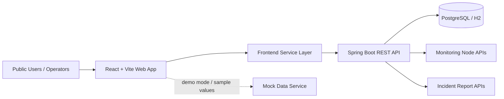

# PahadSuraksha
### AI-Assisted Landslide Monitoring and Early-Warning Platform

<p align="center">
  <strong>Monitor Risk. Report Hazards. Support Faster Response.</strong>
</p>

<p align="center">
  A disaster-risk monitoring and public-awareness prototype designed for landslide-prone regions of Northeast India, with a focus on location-based risk information, monitoring data, incident reporting, and response coordination.
</p>

<p align="center">
  <a href="https://sih-2k26-five.vercel.app/">Live Demo</a> ·
  <a href="https://github.com/Mayank-Mehta242/Sih-2k26">Source Code</a>
</p>

---

## Overview

**PahadSuraksha** is a web-based landslide monitoring and early-warning project developed in the context of the Smart India Hackathon 2026 problem space for an **AI-based early-warning and landslide-risk monitoring system for the North Eastern Region (NER)**.

The project explores how a unified platform can present risk-related information, monitoring-station telemetry, active alerts, citizen-submitted reports, and operational views in one place. Its interface is designed to serve both the public and users responsible for monitoring and responding to potential hazards.

The repository currently contains a React frontend demonstration and a Java/Spring Boot backend service. The frontend includes simulated monitoring and alert data for demonstration; the presence of a dashboard or a risk label should not be interpreted as proof of live sensor connectivity or a validated predictive model.

> **Safety notice:** PahadSuraksha is a prototype and decision-support concept, not an official government warning service. It must not replace official advisories, local emergency instructions, field verification, or decisions by authorized disaster-management authorities. Demo values and sample alerts are not real-time hazard information.

## Problem

Landslides and related slope hazards can threaten lives, damage infrastructure, interrupt road connectivity, and isolate communities. Heavy or prolonged rainfall, unstable terrain, and limited access to timely, location-specific information can make monitoring and response difficult.

PahadSuraksha explores a digital workflow to help bring together:
- Risk and monitoring information in a single interface.
- Location-based visualization of zones, stations, and reported incidents.
- Severity-based alerts and monitoring summaries.
- Citizen incident reporting and alert-subscription interfaces.
- Backend APIs and data models for monitoring nodes and incident reports.
- A foundation for future integration of validated geospatial data and machine-learning risk models.

## Key Features

### Public-facing portal
- Government-service-inspired landing page and navigation.
- Regional status, safety information, emergency-contact and public-information sections.
- Area risk-checking interface and incident-reporting entry points.
- Responsive layout for desktop and smaller screens.

### Monitoring and visualization
- Interactive map with risk zones, monitoring stations, road corridors, rivers, and incident markers.
- Monitoring views for telemetry such as rainfall, soil moisture, tilt, vibration, and humidity.
- Risk summaries and sensor-status indicators.
- Time-series charts and severity-based visual indicators.

### Alerts and incident reporting
- Alert feed with severity levels and a detail view.
- Alert acknowledgement interface.
- Citizen landslide-report form with optional evidence upload support in the frontend/backend flow.
- Backend endpoints for landslide reports and monitoring nodes.

### Application and access flows
- Login and registration interfaces.
- Protected-route and authentication-context components in the frontend.
- Dashboard, monitoring, alerts, profile, and settings pages.
- Service layer that separates API calls from UI components and provides a place to configure demonstration data.

**Implementation note:** Some screens and service responses use simulated data. Live integrations, sensor feeds, AI model inference, messaging, and production authentication should be considered available only when they are configured and verified in the target environment.

## Technology Stack

| Layer | Technologies |
|---|---|
| Frontend | React 18, JavaScript, Vite |
| Routing and UI | React Router, Radix UI primitives, Tailwind CSS, Lucide React |
| Maps and visualization | Leaflet, React Leaflet, Recharts |
| Backend | Java 21, Spring Boot |
| API and validation | Spring Web, Spring Data JPA, Spring Validation |
| Database support | PostgreSQL and H2 runtime dependencies |
| Additional integrations | Twilio SDK and Cloudinary SDK dependencies are present in the backend build |
| Build tools | npm, Maven Wrapper |

The repository includes a Spring Boot backend and a frontend folder named `forntend` (spelling preserved from the current repository structure).

## Architecture



The frontend service layer centralizes HTTP requests and authentication headers. The backend exposes REST endpoints for application resources, including monitoring nodes and landslide reports. Demo-mode/sample data can be used by parts of the interface without a live data source.

### Conceptual risk-monitoring workflow

1. Collect available weather, terrain, monitoring, and incident data.
2. Validate source, timestamp, location, and data quality.
3. Visualize monitoring readings and reported hazards.
4. Assess risk using a validated model or documented rules when such a component is configured.
5. Present relevant risk information and incidents to users.
6. Enable authorized personnel to review reports and coordinate response.
7. Record verification and resolution information where supported.

This is the intended operational concept. It does not mean every stage is automated or connected to live operational data in the current deployment.

## Repository Structure

```text
Sih-2k26/
├── backend/
│   └── LandSlideEarlyWarning-System-Backend/
│       ├── src/
│       │   ├── main/
│       │   │   ├── java/                 # Spring Boot controllers, entities, DTOs and repositories
│       │   │   └── resources/            # Application configuration
│       │   └── test/                     # Backend tests and test configuration
│       ├── Dockerfile
│       ├── pom.xml
│       ├── mvnw
│       └── mvnw.cmd
├── forntend/
│   └── landslide_detection/
│       ├── public/
│       ├── src/
│       │   ├── components/               # Shared UI and feature components
│       │   ├── context/                  # Authentication and toast contexts
│       │   ├── hooks/                    # Reusable React hooks
│       │   ├── layouts/                  # Public and dashboard layouts
│       │   ├── pages/                    # Landing, monitoring, alerts, dashboard, etc.
│       │   ├── services/                 # API wrappers and mock data
│       │   └── utils/                    # Formatters and validators
│       ├── package.json
│       └── vite.config.js
├── package.json                          # Root convenience scripts
└── README.md
```

## Getting Started

### Prerequisites

Install the following before running the project:
- Node.js and npm.
- Java 21 JDK.
- A working internet connection for package installation and any external map tiles.
- PostgreSQL if you intend to run against PostgreSQL; the backend test configuration uses H2.

### 1. Clone the repository

```bash
git clone https://github.com/Mayank-Mehta242/Sih-2k26.git
cd Sih-2k26
```

### 2. Run the frontend

From the repository root:

```bash
npm install
npm run dev
```

The root scripts delegate to the frontend project in `forntend/landslide_detection`. Vite prints the local development URL in the terminal, commonly `http://localhost:5173`.

To create and preview a production build:

```bash
npm run build
npm run preview
```

Alternatively, run commands directly inside the frontend folder:

```bash
cd forntend/landslide_detection
npm install
npm run dev
```

### 3. Configure and run the backend

Open a second terminal and move into the backend directory:

```bash
cd backend/LandSlideEarlyWarning-System-Backend
```

On Windows PowerShell:

```powershell
.\mvnw.cmd spring-boot:run
```

On macOS/Linux:

```bash
chmod +x ./mvnw
./mvnw spring-boot:run
```

The backend README specifies port **8080**. Configure database connection properties for your environment before running against PostgreSQL. The application uses Spring Boot configuration, so use environment-specific settings rather than committing credentials.

Common PostgreSQL environment variables include:

```text
SPRING_DATASOURCE_URL
SPRING_DATASOURCE_USERNAME
SPRING_DATASOURCE_PASSWORD
```

Set these to values appropriate for your own database. Do not commit API tokens, database passwords, messaging credentials, or other secrets.

### 4. Frontend environment configuration

The frontend API client supports these optional Vite environment variables:

| Variable | Purpose |
|---|---|
| `VITE_API_BASE_URL` | Base URL for the primary API; defaults to the deployed origin's `/api` path in the browser |
| `VITE_NODES_API_BASE_URL` | Optional separate base URL for node-related endpoints |
| `VITE_USE_MOCKS` | Set to `true` to enable mock behavior where supported by the frontend services |

Create a local `.env.local` file in `forntend/landslide_detection` when configuration is needed. Restart the Vite server after changing environment variables. Never put private secrets in variables prefixed with `VITE_`; those values are bundled into the client application.

The backend and frontend must be configured to use compatible API URLs and routes for end-to-end functionality.

## Testing

Run backend tests from the repository root on Windows:

```powershell
npm run backend:test
```

Or run them directly from the backend directory:

```powershell
.\mvnw.cmd test
```

The backend test configuration uses an in-memory H2 database. Frontend build verification:

```bash
npm run build
```

A successful build confirms compilation and bundling, not the accuracy of a landslide-risk model or the reliability of live monitoring integrations.

## Deployment

A demonstration frontend is available at:

**[https://sih-2k26-five.vercel.app/](https://sih-2k26-five.vercel.app/)**

Deployment configuration, backend availability, environment variables, API connectivity, and data freshness may change over time. Confirm these in the deployed environment before relying on any displayed result. The live demo should be treated as a project demonstration unless live data sources and operational status are explicitly verified.

## AI/ML Roadmap

The project is intended to support future data-driven risk assessment. A credible predictive system requires more than displaying a risk label.

Potential next steps include:
1. Identify a clear prediction target and forecast horizon.
2. Gather traceable, appropriately labelled landslide and non-landslide records.
3. Integrate rainfall accumulation, slope, elevation, land cover, geology, and incident-history features where reliable data is available.
4. Establish a reproducible preprocessing and feature-engineering pipeline.
5. Compare a baseline model with candidates such as Random Forest and XGBoost; evaluate image-based models only where suitable labelled imagery exists.
6. Evaluate precision, recall, F1-score, PR-AUC, calibration, false negatives, and performance across locations and seasons.
7. Expose model version, input timestamp, uncertainty, and data freshness alongside predictions.
8. Validate results with domain experts before any operational use.

**No model accuracy or predictive performance is claimed in this README.** Such metrics should be published only after evaluation on a documented, held-out dataset.

## Security and Responsible Use

- Keep secrets and production credentials out of source control.
- Configure CORS, authentication, authorization, input validation, and upload limits for the intended deployment.
- Do not treat stale or missing readings as evidence of safe conditions.
- Make sample/demo values visibly distinguishable from verified observations.
- Protect sensitive location, user, and incident information.
- Route emergency decisions through authorized officials and official procedures.

## Contributing

Contributions and constructive feedback are welcome.

1. Fork the repository.
2. Create a feature branch: `git checkout -b feature/your-feature`.
3. Make focused changes and test them.
4. Commit your changes: `git commit -m "Add: describe your change"`.
5. Push the branch and open a pull request describing the change, testing performed, and any configuration requirements.

## Future Enhancements

- Integrate reliable weather, terrain, and geospatial datasets.
- Connect real monitoring devices and define data-quality checks.
- Implement and evaluate a reproducible landslide-risk model.
- Improve authority workflows for incident review, assignment, and resolution.
- Add notification delivery with consent, deduplication, and delivery-status tracking.
- Add automated tests, observability, and deployment documentation.

## Acknowledgements

This project was developed around the Smart India Hackathon 2026 problem space for landslide-risk monitoring and early warning in the North Eastern Region. Data providers, map providers, and third-party services should be credited according to the sources actually used in a deployment.

## License

No license is currently specified in the repository. Unless a license is added, reuse, redistribution, and modification are subject to the default copyright rules. Add an appropriate open-source license if you intend to permit reuse.

---

**PahadSuraksha — an engineering prototype for exploring safer, more informed disaster-risk monitoring.**
