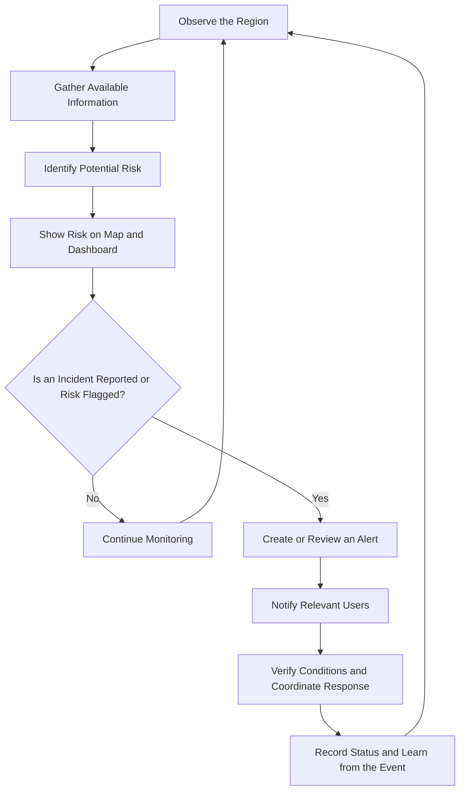
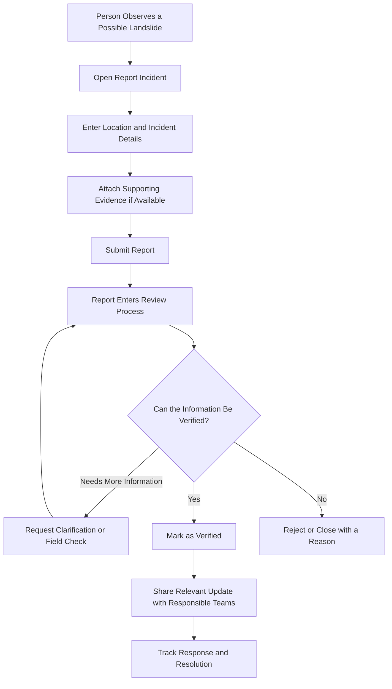
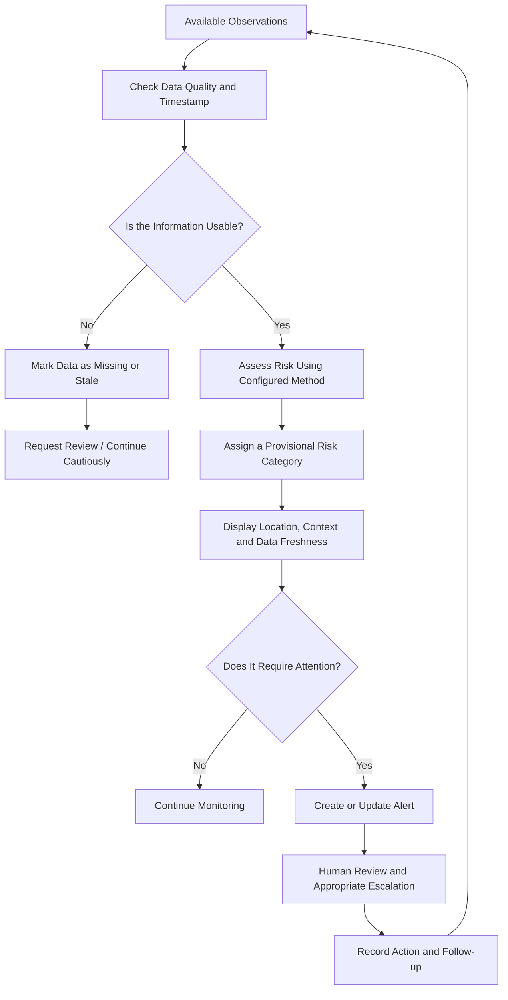
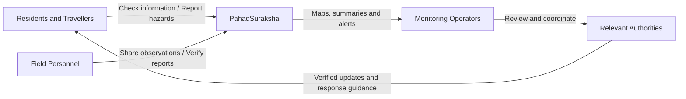

# PahadSuraksha
### Landslide Risk Monitoring & Early-Warning Support Platform

<p align="center">
  <strong>Observe Early. Understand Risk. Coordinate Response.</strong>
</p>

<p align="center">
  A disaster-risk platform concept to help communities and response teams understand landslide-related threats, report incidents, and coordinate timely action in vulnerable hill regions.
</p>

<p align="center">
  <a href="https://sih-2k26-five.vercel.app/"><strong>Live Demo</strong></a> ·
  <a href="https://github.com/Mayank-Mehta242/Sih-2k26"><strong>GitHub Repository</strong></a>
</p>

---

## 1. What is PahadSuraksha?

Landslides can damage roads, disrupt essential services, and put communities at risk—especially during periods of intense or prolonged rainfall. Responding effectively requires more than a map or an alert: information must be noticed, assessed, communicated, and followed by action.

**PahadSuraksha** is a Smart India Hackathon 2026 project concept for landslide-risk monitoring and early-warning support in the North Eastern Region (NER) of India. It brings monitoring views, risk-zone visualization, alerts, and incident reporting together in one web-based experience.

The aim is to support a clearer chain from **observing a possible hazard to reviewing it and coordinating a response**.

> **Important:** This is a prototype, not an official government warning system. Some interface values and alerts are simulated. Do not use the demo to make real-world safety decisions or treat its displayed risk levels as verified forecasts. Follow official advisories and local emergency instructions.

## 2. The Big Picture

The platform is organized around a simple principle: information is useful when it leads to an informed next step.



*This diagram represents the intended operating concept. It is not a claim that every stage is automated or connected to live data in the current demo.*

## 3. How It Works

### Step 1 — Observe
Bring relevant information about a region into view, such as rainfall, terrain context, monitoring readings, and previously reported incidents, where those sources are available.

### Step 2 — Understand
Present available observations in a readable form. Risk assessment should account for the source and freshness of data, the local context, and the limitations of any model or rule being used.

### Step 3 — Locate
Use a map and area summaries to help users understand where a potential concern has been reported and which nearby zones or routes may need attention.

### Step 4 — Report and Review
Allow a citizen or field user to submit an incident report. The report can then be reviewed and verified by the appropriate responsible personnel before being treated as confirmed.

### Step 5 — Communicate
Present alerts and relevant safety information so users can understand the nature and severity of a concern. Real notification delivery requires correctly configured services and verified recipients.

### Step 6 — Respond and Update
Response teams can use verified information and official procedures to determine next steps. Incident status should be updated as new information becomes available.

## 4. Incident Reporting Workflow



The workflow describes a responsible reporting process: a submitted report is a signal for review, not automatic proof that a landslide has occurred.

## 5. Risk Monitoring and Alert Lifecycle



A reliable early-warning workflow must distinguish a real observation from sample data, show when information was last updated, and make uncertainty visible. Risk categories alone are not a substitute for expert assessment.

## 6. Main Areas of the Platform

- **Regional overview:** a public-facing entry point for area status, safety information, and key updates.
- **Risk map:** a geographic view of zones, monitoring stations, roads, rivers, and incident markers.
- **Monitoring dashboard:** sensor-status summaries and visualizations of example telemetry readings.
- **Alerts:** a severity-based list with details and an acknowledgement interface.
- **Check your area:** an entry point for location-related risk information.
- **Report an incident:** a form for sharing a possible landslide or related hazard.
- **User and operator pages:** login, registration, dashboard, profile, and settings interfaces.

Some of these experiences currently use demonstration data. Live sensor feeds, validated predictions, and end-to-end notification delivery must be separately configured and tested before they can be relied on.

## 7. Who Is It For?



The intended users include people seeking public safety information, field personnel reporting conditions, and monitoring or response teams reviewing possible hazards. Actual authority assignment and official escalation depend on the procedures of the responsible agencies.

## 8. Project at a Glance

| | |
|---|---|
| **Project** | PahadSuraksha |
| **Domain** | Disaster risk reduction and landslide early-warning support |
| **Problem space** | Smart India Hackathon 2026 — landslide-risk monitoring for the North Eastern Region |
| **Primary goal** | Connect observations, risk information, incident reporting, and response workflows |
| **Current status** | Prototype with frontend demonstration and backend service |
| **Demo** | [sih-2k26-five.vercel.app](https://sih-2k26-five.vercel.app/) |

## 9. Run the Project Locally

### Requirements
- Node.js and npm
- Java 21
- PostgreSQL for a local PostgreSQL-backed run, with valid connection settings

### Start the frontend

Clone the repository and enter the project folder:

```bash
git clone https://github.com/Mayank-Mehta242/Sih-2k26.git
cd Sih-2k26
npm install
npm run dev
```

Vite prints the local development URL in the terminal.

### Start the backend

In a second terminal:

```bash
cd backend/LandSlideEarlyWarning-System-Backend
```

Windows PowerShell:

```powershell
.\mvnw.cmd spring-boot:run
```

macOS/Linux:

```bash
chmod +x ./mvnw
./mvnw spring-boot:run
```

The backend is configured to run on port **8080** by default. Configure the database connection for your environment before starting it. Do not commit passwords, tokens, or other private credentials.

To build the frontend for production:

```bash
npm run build
```

To run backend tests from the backend folder:

```powershell
.\mvnw.cmd test
```

## 10. Future Direction

The next stage is to strengthen the system behind the interface:

1. Connect trusted, timestamped weather and geospatial sources.
2. Define a clear risk-prediction target and forecast window.
3. Build and evaluate a model using documented, appropriately labelled historical data.
4. Show data freshness, model version, uncertainty, and reasons for a risk flag.
5. Improve incident verification, ownership, escalation, and resolution tracking.
6. Test notification delivery, reliability, access control, and audit trails.
7. Validate the workflow with domain experts before any operational deployment.

Model performance should only be reported after rigorous evaluation on held-out data. This README does not claim a particular prediction accuracy or that the current demo provides a verified live forecast.

## 11. Responsible Use

- Treat demo data as illustrative, not as real observations.
- Do not interpret missing data as a safe condition.
- Keep sensitive information and credentials protected.
- Verify incidents and high-risk observations through appropriate procedures.
- Defer to official disaster-management authorities and emergency services for real-world decisions.

## Contributing

Suggestions, issue reports, and contributions are welcome. Please describe the problem, the proposed change, and how you tested it when opening an issue or pull request.

## License

A license has not yet been specified in this repository. Add a license file if you intend to grant others explicit permission to use, modify, or redistribute the project.

---

<p align="center">
  <strong>PahadSuraksha</strong><br/>
  From observation to awareness, and from awareness to coordinated response.
</p>
